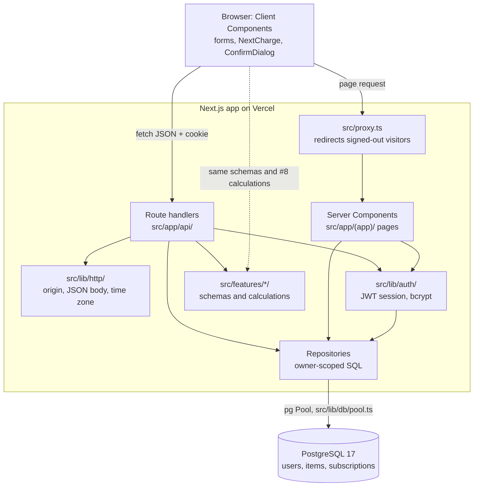
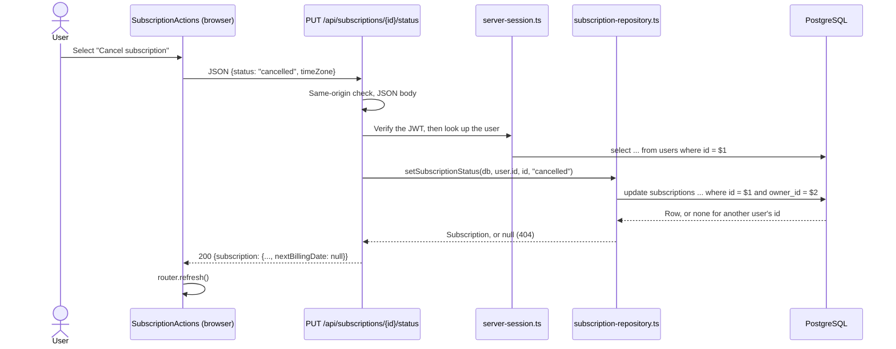
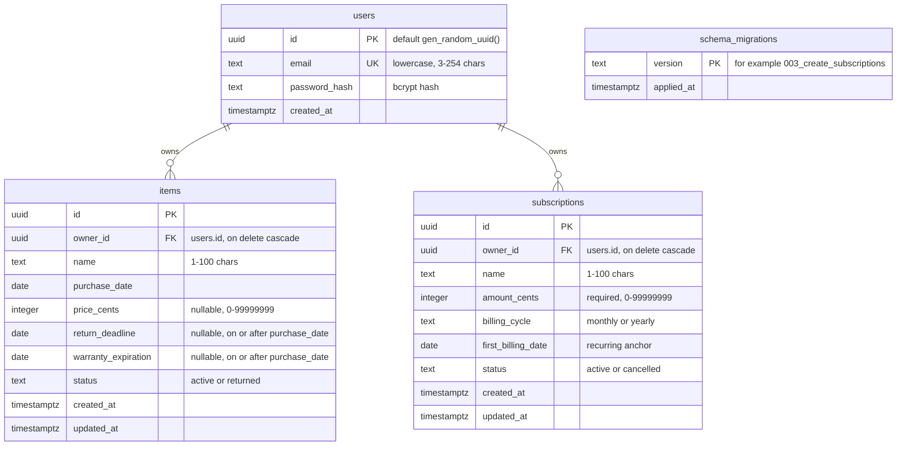
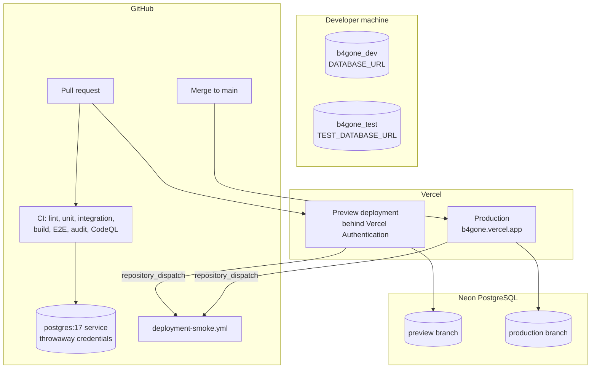

# Architecture

B4Gone is one Next.js 16 application (App Router, React 19, TypeScript) backed by one PostgreSQL database. There is no separate API server, no ORM, and no client-side state library. This page describes what is on `main` at `7db64cd` (2026-11-09). The dashboard's deadline list (#9) is in review in [#30](https://github.com/char-lv/b4gone/pull/30) and is not described here as built. Until #30 merges, `/dashboard` shows a placeholder empty state.

## How a request flows

**Pages read on the server.** List and detail pages under `src/app/(app)/` are async Server Components. They get the signed-in user from `getCurrentUser()` in `src/lib/auth/server-session.ts`. Then they call a repository directly, for example `listSubscriptions(getPool(), user.id)`. The browser never sees SQL or the database connection.

**Changes go through the API.** Forms and buttons are Client Components. They validate input with the same schema the server uses, then send JSON to a route handler with `fetch`. After a successful save they call `router.refresh()`, so the Server Components re-read the list and details. A failed save keeps the draft and shows an error.

**Route handlers stay thin.** Each handler in `src/app/api/` does the same steps in order:

1. For changes, check that the request came from the same origin (`isSameOriginRequest`). Otherwise return `403`.
2. Look up the user from the session cookie. Otherwise return `401`.
3. Require a JSON body (`readJson`) and the caller's `timeZone`. Otherwise return `400 invalid_json` or a field error.
4. Validate with the shared schema. Otherwise return `400 validation_failed` with errors per field.
5. Call the repository with `user.id` as the owner.
6. Return a camelCase JSON response.

A failure inside these steps returns `500` with a generic message; the internal error never goes back to the client.

**Server-only code.** The repositories, `server-session.ts`, `password.ts`, `auth-service.ts`, and `src/lib/db/pool.ts` import `server-only`, so a Client Component that imported one of them would fail the build.

### Example: cancelling a subscription

## Authentication

Accounts were built in #2 ([#20](https://github.com/char-lv/b4gone/pull/20)).

- Passwords are hashed with bcryptjs (cost 12). Passwords longer than bcrypt's 72-byte limit are rejected instead of silently truncated.
- Sign-in sets a jose HS256 JWT in the `b4gone_session` cookie: HttpOnly, SameSite=Lax, Secure in production, and valid for 7 days. The token holds only the user id and its expiry. No token is stored in `localStorage`.
- `src/proxy.ts` runs before `/dashboard`, `/items`, and `/subscriptions`. It redirects a visitor without a valid token to `/sign-in?next=...`. This is only a first check: every page and route handler still verifies the token and loads the user from the `users` table. A deleted account therefore stops working even if its token has not expired.
- `?next=` targets pass through `safe-redirect.ts`, which accepts only same-site paths.

## Code layout

| Location | What is there |
| --- | --- |
| `src/app/(auth)/` | Sign-in and registration pages |
| `src/app/(app)/` | Signed-in layout and navigation, plus the Dashboard, Items, and Subscriptions pages with their loading, error, and not-found states |
| `src/app/api/` | `auth/{register,login,logout,me}`, `items`, `items/{id}`, `items/{id}/status`, `subscriptions`, `subscriptions/{id}`, `subscriptions/{id}/status` |
| `src/features/auth/`, `items/`, `subscriptions/` | Each feature's forms and views, its shared schema, its repository, and its client request helper |
| `src/components/ui/` | `Button`, `FormField`, `ConfirmDialog`, `ErrorPanel`, `BackLink`, `Wordmark` |
| `src/lib/` | Date-only helpers, money parsing, recurrence, record-name rules, HTTP helpers, auth, and the database pool |
| `db/migrations/` | `001_create_users.sql`, `002_create_items.sql`, `003_create_subscriptions.sql` |
| `scripts/` | `db:check`, `db:migrate`, and the smoke check |

The full endpoint contract, including request and response examples and every error code, is in [api/openapi.yaml](api/openapi.yaml).

## Database

The schema comes only from the three migration files. `npm run db:migrate` applies them in order, each inside a transaction, and records each version in `schema_migrations`.

`schema_migrations` is created by the migration runner (`scripts/lib/migrations.ts`), not by a migration file, and it has no relationship to the other tables.

| Table | Constraints and indexes |
| --- | --- |
| `users` | Unique index `users_email_key` on `email`; checks `users_email_lowercase` and `users_email_length` |
| `items` | Checks `items_name_length`, `items_price_range`, `items_return_after_purchase`, `items_warranty_after_purchase`, `items_status` (default `active`); index `items_owner_purchase_idx` on `(owner_id, purchase_date desc)` |
| `subscriptions` | Checks `subscriptions_name_length`, `subscriptions_amount_range`, `subscriptions_billing_cycle`, `subscriptions_status` (default `active`); index `subscriptions_owner_name_idx` on `(owner_id, lower(name))` |

The database checks back up the shared validation; they do not replace it. Some rules exist only in the schemas, because a simple check cannot express them. These are trimming, a visible character in names, one-line names, and "purchase date not after today", which depends on the user's time zone.

### Design decisions

**Dates are date-only.** Purchase dates, deadlines, and the first billing date are PostgreSQL `DATE` columns. The repositories read them with `to_char(column, 'YYYY-MM-DD')`, so they reach the app as plain strings and never pass through a JavaScript `Date` or a UTC timestamp. "Today" comes from the user's time zone. The browser sends `timeZone` with each request, and `src/lib/http/user-today.ts` turns it into a `YYYY-MM-DD` date. For example, at 02:30 UTC a user in New York is still on the previous day. The integration tests check that case.

**Money is integer cents.** `src/lib/money.ts` parses `"15.99"` into `1599`. It rejects negative amounts, more than two decimals, and malformed separators such as `1,,2` or `1,200`, instead of rounding or stripping them. Item price is optional, and blank and zero are different values (`null` and `0`). Subscription amount is required, and `0` means a free plan. The limit of 99999999 cents ($999,999.99) keeps `amount × 12` a safe integer for the monthly average. Formatting as USD happens only for display.

**Every query is owner-scoped.** Each repository function takes `ownerId` from the verified session and puts `owner_id = $n` in its SQL, including list and detail reads. Another user's record, a missing record, and a malformed id all return the same `404`, so an id from someone else's account reveals nothing. The two-user integration tests cover list, detail, edit, status, and delete for both items and subscriptions.

**Next charges are calculated, never stored.** `first_billing_date` is the anchor. `nextBillingDate` in `src/lib/recurrence.ts`, plus `nextRenewals` and `averageMonthlyCostCents` in `src/features/subscriptions/subscription-calculations.ts`, are the #8 functions ([contract](subscription-calculations.md)). The API, the subscription pages, and the form preview all call them. Nothing else computes a billing date or a total. Cancelling changes only `status`, so reactivating recalculates from the original anchor. A January 31 monthly anchor gives February 28 (or 29), then March 31.

**Status changes keep the record.** Returning an item or cancelling a subscription keeps the row and changes `status`. Undo and reactivate change it back. Delete removes the row after a confirmation dialog.

## Environments

- **Local:** a development database and a separate `_test` database. `src/lib/db/config.ts` refuses a test database whose name does not end in `_test` or that matches `DATABASE_URL`. See [setup.md](setup.md).
- **CI:** every pull request and every push to `main` run against a disposable `postgres:17` service. CI has no production secrets.
- **Preview and production:** Vercel has separate Preview and Production values for `DATABASE_URL` and `SESSION_SECRET`. They point to two Neon branches through pooled connection strings. Migrations are applied by hand through each branch's direct connection string: preview first, then production after review and before the merge. See [deployment.md](deployment.md).
- **Smoke check:** after each Vercel deployment, `deployment-smoke.yml` requests the homepage. Previews are reached through the `VERCEL_AUTOMATION_BYPASS_SECRET` header. The smoke check does not sign in or touch the database.

Not built yet: a health route that queries the database, a seed script, and branch protection on `main`. They are tracked in [P2_CHECKLIST.md](P2_CHECKLIST.md).
